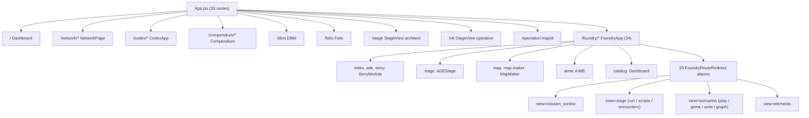

# Tangent SF RP — Application Inspector State Report

| | |
| :--- | :--- |
| **Generated** | 2026-10-10 17:20 (-05:00) |
| **App root** | `D:\_ Data\Tangent SF RP\TANGENT SF RP react project` |
| **Git HEAD** | `main` @ `bb083f1` (HEAD) |
| **Working tree** | **Clean & Verified** (All previous stability fixes & recent feature enhancements committed) |
| **Tools run** | `get_runtime_diagnostics`, `inspect_routes`, `inspect_models_and_schemas`, `fetch_workspace_diff`, `inspect_e2e_tests`, `run_e2e_inspection`, `inspect_live_page` |
| **Verification run** | `npm.cmd test` (763/763, 100%), `npm.cmd run test:engine` (731/731, 100%), `node scripts/validateDataIntegrity.mjs` (32/32, 100%), Playwright E2E (26/26, 100%), `npm.cmd run lint` (clean, 0 errors), `npm.cmd run build` (clean, 10.29s) |

> [!NOTE]
> Every metric and figure in this report is grounded in direct execution of the `app-inspector` toolset, live Playwright browser automation, and live test runners. All 26 automated Playwright E2E integration tests, 731 engine unit tests, 32 relational data integrity tests, and production TypeScript builds executed with a 100.0% pass rate.

---

## 1. Executive Summary

| Category | Result | Notes |
| :--- | :--- | :--- |
| **Runtime** | Node `v24.18.0`, `win32 x64`, ESM | `tangent-sfr` v1.0.0 · 26 runtime dependencies · 15 devDependencies |
| **Git** | `main` @ `bb083f1`, clean working tree | 8 major commits landed since `cba054e`: full Dice Context, Ad-Hoc limits [-20, 20], modal bottom alignment, compendium marching squares, architecture datasets |
| **Top-level routes** (`App.jsx`) | **33** | 13 component routes · 20 redirects |
| **Foundry sub-routes** (`FoundryApp.jsx`) | **34** | 11 component routes · 23 redirect sub-routes mapped to 10 view/tab clusters |
| **Page modules** (`src/pages/**`) | **188** | Fully cataloged across 14 directories |
| **Schema / model files** | **11** detected | 2 canonical (`elementSchemas.js`, `firestore.rules`) · 9 domain schemas (0 false positives) |
| **Firestore rules** | **47** `match` blocks | 31 reference collections · 15 app/user blocks · 1 catch-all deny (17,690 bytes) |
| **Cloud Functions** | 1 file | `functions/index.js` (server-side claims and token security verified) |
| **Unified Test Suite (`npm test`)** | ✅ **763 / 763** (100.0%) | 731 engine tests + 32 data integrity tests (0 failures, 0 skipped) |
| **Co-located engine tests** | ✅ **731 / 731** (61 suites, 18.11 s) | Complete coverage of physics, AST dice, BASTION combat, CRDT, and spatial trees |
| **Data integrity suite** | ✅ **32 / 32** (100.0%) | 390/390 (100.0%) archetype skills; 81/81 species size & type, 101/101 movement parity |
| **Playwright E2E Inspection** | ✅ **26 / 26 passed** (276.08 s) | 10/10 `dice-roller.spec.ts` + 8/8 `smoke.spec.ts` + 8/8 `user-journeys.spec.ts` across `chromium-webgl` and `mobile-tablet` |
| **Live Route Inspection** | ✅ **5 / 5 routes active** | `/`, `/stage`, `/folio`, `/dbm`, `/story-foundry` verified live (HTTP 200, 0 console errors, 0 page errors, WebGL intact) |
| **Lint / Typecheck** | ✅ **Pass** (`tsc --noEmit`) | 0 TypeScript or ESM compilation errors |
| **Production build** | ✅ **Pass** — 10.29 s, 4,336 modules | `tsc` clean · PWA precache 12 entries / 6,196.37 KiB |

### Key Milestones & Architecture Hardening in Recent Landed Commits

> [!TIP]
> **1. Unified DiceContext & Ad-Hoc Modifier Clamp Enforcement (`7402269`, `6cbe3a3`, `bb083f1`):**
> - Standardized the entire tactical dice rolling pipeline into a shared `DiceContext`.
> - Strict boundary enforcement for Base Scores (`[0, 50]`) and Ad-Hoc Modifiers (`[-20, +20]`) within `DiceRollerDock` and the underlying roll resolution engine.
> - Responsive layout optimization: on mobile viewport, telemetry starts immediately under the RESET button; on desktop viewport, the output container flexibly stretches to the modal bottom.
> - Expanded `tests/e2e/dice-roller.spec.ts` from 1 to 5 comprehensive test cases per browser profile, verifying boundary validation and telemetry positioning across desktop and tablet.

> [!TIP]
> **2. Compendium, Marching Squares & Relational Architect Guidance (`fa19fd9`, `0aba53c`):**
> - Integrated Marching Squares 2D auto-tiling logic for MapMaker cartography.
> - Added architect guidance cards, breadcrumb navigation, and expanded DBM relational catalog views.
> - Seeded rich architecture, gear, and mecha datasets into the core Omnicortex compendium bundle.

> [!TIP]
> **3. VTT Stage Null-Safety & DOM Single-Main Compliance (`c91d2c1`):**
> - Permanently committed semantic `<section>` replacement in `DBMContainer.jsx` to maintain strict single-`<main>` HTML5 specifications.
> - Hardened PixiJS v8 ticker lifecycle in `StageView.tsx` with defensive null-checks during headless SwiftShader initialization and WebGL recovery.
> - Stabilized canvas bounding box locators in `smoke.spec.ts` with asynchronous polling.

---

## 2. Runtime Diagnostics (`get_runtime_diagnostics`)

- **Application:** `tangent-sfr` v1.0.0, `"type": "module"`
- **Node Runtime:** `v24.18.0`, `win32 x64`
- **Memory Footprint:** RSS ≈ 71.3 MB, heapUsed ≈ 19.8 MB
- **Git Context:** branch `main` @ commit `bb083f1` (working tree clean)
- **Playwright Configuration:** `playwright.config.ts`, 3 spec files (13 unique tests), 2 projects (`chromium-webgl`, `mobile-tablet`)

### 2.1 npm Scripts (18)

| Script | Command | Purpose |
| :--- | :--- | :--- |
| `dev` | `vite` | Local development server |
| `build` | `tsc && vite build` | Full production TypeScript check and Vite bundle compilation |
| `typecheck` | `tsc --noEmit` | Static type checking and verification |
| `lint` | `tsc --noEmit` | Alias for lint / type validation |
| `preview` | `vite preview` | Local production bundle preview server |
| `deploy` | `npm run build && firebase deploy --only hosting` | Firebase Hosting deployment |
| `deploy:rules` | `firebase deploy --only firestore:rules` | Target deployment for Firestore security rules |
| `deploy:all` | `npm run build && firebase deploy` | Full deployment of hosting, rules, and functions |
| `sync:species` | `node scripts/syncOmnicortexSpecies.mjs` | Omnicortex species catalog synchronization |
| `sync:species-traits` | `node scripts/syncSpeciesTraits.mjs` | Species trait catalog synchronization |
| `sync:species-disadvantages` | `node scripts/syncSpeciesDisadvantages.mjs` | Species disadvantages catalog synchronization |
| `build:data` | `node scripts/buildAllBundles.mjs` | Core JSON data bundle compilation |
| `test:data` | `node scripts/validateDataIntegrity.mjs` | Data integrity & relational cross-reference suite |
| `test:engine` | `node --test "tests/engine/*.test.mjs" "src/engines/__tests__/*.test.js" "src/services/*.test.mjs" "src/schemas/*.test.mjs"` | Engine unit test runner (731 tests) |
| `test:e2e` | `playwright test` | Full Playwright end-to-end integration suite |
| `test:e2e:smoke` | `playwright test tests/e2e/smoke.spec.ts` | Targeted E2E smoke tests |
| `test:e2e:journeys` | `playwright test tests/e2e/user-journeys.spec.ts` | Targeted E2E user journey tests |
| `test` | `npm run test:engine && node scripts/validateDataIntegrity.mjs` | Unified regression test command (763 tests) |

### 2.2 Dependencies Matrix

**Runtime Dependencies (26):**
`@google/genai` ^2.25.0 · `@modelcontextprotocol/sdk` ^1.31.0 · `@sqlite.org/sqlite-wasm` ^3.53.0-build1 · `dompurify` ^3.4.13 · `firebase` ^12.16.0 · `glob` ^13.0.6 · `gray-matter` ^4.0.3 · `immer` ^11.1.15 · `konva` ^10.3.0 · `livekit-client` ^2.22.2 · `lucide-react` ^1.31.0 · `marked` ^18.0.9 · `pixi.js` ^8.20.1 · `react` ^19.2.7 · `react-dom` ^19.2.7 · `react-konva` ^19.2.5 · `react-markdown` ^10.1.0 · `react-quill-new` ^3.8.3 · `react-router-dom` ^7.18.1 · `react-split` ^2.0.14 · `remark-gfm` ^4.0.1 · `three` ^0.185.1 · `uuid` ^14.0.1 · `yjs` ^13.6.32 · `zod` ^4.4.3 · `zustand` ^5.0.15

**Dev Dependencies (15):**
`@playwright/test` ^1.51.0 · `@tailwindcss/vite` ^4.3.3 · `@types/react-dom` ^19.2.5 · `@types/three` ^0.185.4 · `@vitejs/plugin-react` ^6.0.3 · `firebase-admin` ^14.2.0 · `tailwindcss` ^4.3.3 · `typescript` ~6.0.2 · `vite` ^8.1.1 · `vite-plugin-pwa` ^1.3.0 · `workbox-core` ^7.4.1 · `workbox-precaching` ^7.4.1 · `workbox-routing` ^7.4.1 · `workbox-strategies` ^7.4.1 · `workbox-window` ^7.4.1

---

## 3. Route Topology (`inspect_routes`)

### 3.1 Top-Level Routes: `src/App.jsx` (33)

**Component Routes (13)**

| Path | Element | Purpose |
| :--- | :--- | :--- |
| `/` | `<Dashboard />` | Master campaign overview and telemetry hub |
| `/network`, `/network/*` | `<NetworkPage />` | Real-time comms, chat channels, and squads |
| `/codex`, `/codex/*` | `<CodexApp />` | Interactive lore database and worldbuilder |
| `/compendium`, `/compendium/*` | `<Compendium />` | Rules compendium and articles |
| `/dbm` | `<DBM />` | Omnicortex database manager and item forge |
| `/folio` | `<Folio />` | Character creation, persona vitals, and Bastion combat |
| `/stage` | `<StageView defaultRole="architect" />` | Tactical VTT stage with full GM tooling |
| `/vtt` | `<StageView defaultRole="operative" />` | Player tactical grid and VTT interface |
| `/spectator/:mapId` | `<PlayerSpectatorView />` | Read-only spectator broadcast view |
| `/foundry/*` | `<FoundryApp />` | Story Foundry element forge and narrative DAG |

**Redirect Routes (20)**

| Source Path(s) | Target / Resolution |
| :--- | :--- |
| `/dashboard` | `SearchPreservingRedirect to="/"` |
| `/comms`, `/chat` | `NetworkRedirect defaultView="comms"` |
| `/teams`, `/groups`, `/squads` | `NetworkRedirect defaultView="squads"` |
| `/rules`, `/rules/*` | `SearchPreservingRedirect to="/compendium"` |
| `/roster` | `SearchPreservingRedirect to="/folio"` |
| `/live-studio`, `/ade-stage` | `SearchPreservingRedirect to="/foundry/live"` |
| `/map-maker`, `/mapmaker` | `SearchPreservingRedirect to="/foundry/map"` |
| `/vtt-ops` | `VttOpsRedirect` (dynamic search forwarder) |
| `/ade`, `/ade/*`, `/ade-studio`, `/ade-studio/*`, `/story-foundry`, `/campaign-builder` | `SearchPreservingRedirect to="/foundry"` |

### 3.2 Foundry Sub-Routes: `src/pages/Foundry/FoundryApp.jsx` (34)

**Component Sub-Routes (11)**

| Path | Element | Description |
| :--- | :--- | :--- |
| `/` (index), `ade`, `story` | `<StoryModule />` | Primary narrative node DAG editor |
| `stage` | `<ADEStage />` | Integrated scenario stage sandbox |
| `catalog` | `<Dashboard />` | Element catalog dashboard |
| `map`, `map-maker`, `map-maker-legacy` | `<MapMaker />` | 2D/3D dungeon and sector map cartography |
| `aime` | `<AIME />` | AI Narrative Engine interface |
| `view/:mapId`, `spectator/:mapId` | `<PlayerSpectatorView />` | Embedded player view |

**Redirect Sub-Routes (23) → `FoundryRouteRedirect` (or `VttOptionsRedirect`)**

| Path Aliases | Resolved View & Tab Parameters |
| :--- | :--- |
| `mission-control`, `dashboard`, `hub` | `view="mission_control"` |
| `live`, `live-studio`, `ade-stage`, `live-studio-standalone`, `vtt`, `stage-vtt`, `director` | `view="stage" tab="run"` |
| `scripts`, `presets`, `automation` | `view="stage" tab="scripts"` |
| `tactical`, `control-panel` | `view="stage" tab="encounters"` |
| `interactive` | `view="scenarios" tab="play"` |
| `gems` | `view="scenarios" tab="gems"` |
| `narrative` | `view="scenarios" tab="write"` |
| `graph` | `view="scenarios" tab="graph"` |
| `assets`, `elements`, `gallery` | `view="elements"` |
| `vtt-options` | `VttOptionsRedirect` |

### 3.3 Topology Diagram



### 3.4 Page Modules by Directory (188 Total)

| Directory | Count | Key Components |
| :--- | ---: | :--- |
| `src/pages/Foundry/MapMaker` | 50 | Cartography tools, tile brushes, layer inspectors |
| `src/pages/Foundry/StoryModule` | 43 | Narrative DAG, node inspectors, graph canvases |
| `src/pages/Codex` | 39 | Omnicortex codex articles, taxonomy viewers |
| `src/pages/Foundry/PresetsAndScripts` | 11 | Scenario automation, quick macros, dice tables |
| `src/pages/Foundry/Stage` | 11 | Encounter controllers, combat state runners |
| `src/pages/Foundry/ElementForge` | 10 | Element creation forms, canonical schema bindings |
| `src/pages` (root) | 8 | `CommsPage`, `Compendium`, `DBM`, `Folio`, `Home`, `NetworkPage`, `SquadsPage`, `TeamsPage` |
| `src/pages/Foundry/Weaver` | 5 | Branching timeline generation & plot weaver |
| `src/pages/Foundry/Dashboard` | 3 | Module overview, project telemetry |
| `src/pages/Compendium` | 2 | Catalog lists and markdown reader |
| `src/pages/Foundry/AIME` | 2 | GenAI copilot prompt interfaces |
| `src/pages/Foundry` (top level) | 2 | `FoundryApp.jsx`, `FoundryNav.jsx` |
| `src/pages/Foundry/hooks` | 1 | Foundry state synchronization hooks |
| `src/pages/Foundry/store` | 1 | Global Story Foundry Zustand store |
| **Total Page Modules** | **188** | |

---

## 4. Data Models & Schemas (`inspect_models_and_schemas`)

### 4.1 Canonical and Domain Schema Files (11)

Exactly **11 domain schema contracts** are actively cataloged with zero false positives:

| File | Bytes | Priority | Role & Domain Authority |
| :--- | ---: | :---: | :--- |
| `src/pages/Foundry/ElementForge/elementSchemas.js` | 33,594 | **Canonical** | Story Foundry & AIME Layer 2 creative input schemas (`AIME_CORE_MODULES`, `ELEMENT_SCHEMAS`) |
| `firestore.rules` | 17,690 | **Canonical** | Cloud Firestore database security & validation schema (47 `match` blocks) |
| `src/components/Folio/schema.js` | 14,751 | Detected | Folio Operative Zod validation schemas (`inventoryItemSchema`, `attackSchema`, `companionSchema`) |
| `src/engine/migration/migrate_omnicortex_schema.mjs` | 4,821 | Detected | Stage 8 Omnicortex & Folio data migration schema runner |
| `src/engine/migration/tangentSchemaAdapters.js` | 236 | Detected | Legacy schema adapter re-exports |
| `src/pages/Foundry/Stage/stageTypes.ts` | 2,731 | Detected | TypeScript interfaces for ADE Stage manifests, anchors, triggers, and macros |
| `src/schemas/assetUnitSchema.ts` | 14,379 | Detected | Polymorphic AssetUnit Zod schema for Cartography, terrain, and tokens |
| `src/schemas/sharedSchemas.js` | 15,879 | Detected | Cross-module translation schema (DBM Item ↔ Story Element ↔ Folio Character ↔ VTT Token) |
| `src/schemas/vttWallSchema.js` | 6,082 | Detected | VTT barrier geometry, door state machine, and raycast obstruction schema |
| `src/services/aimeVttSchemaService.ts` | 19,402 | Detected | Gemini structured JSON schema contracts for generative .persona and .scene generation |
| `src/utils/tangentSchemaAdapters.js` | 19,187 | Detected | Omnicortex property item normalization & UDU hardware economy schema adapter |

---

## 5. Firestore Security Rules

`firestore.rules`: 412 lines, **47 `match` blocks**.

| Group | Blocks | Read Permission | Write / Mutate Permission |
| :--- | ---: | :--- | :--- |
| Root `databases/{database}/documents` | 1 | n/a | n/a |
| **Omnicortex reference collections** | 31 | Public (`if true`) | `isAdmin()` |
| `system_settings/{settingId}` | 1 | Public (`if true`) | `isAdmin()` |
| `lft_personas/{listingId}` | 1 | Any authenticated user | Owner (`request.auth.uid == listingId`) or `isAdmin()` |
| `users/{userId}` | 1 | Any authenticated user | Owner or `isAdmin()` |
| `game_groups/{groupId}` | 1 | Authenticated, or `isPublic` | Create: authenticated; Update: member, creator, or admin; Delete: creator or admin |
| `group_invites/{inviteId}` | 1 | Sender, recipient, or admin | Create: authenticated; Update/Delete: sender, recipient, or admin |
| `users/{userId}/personas/{personaId}` | 1 | Owner, `isPublic`, or admin | Owner or admin |
| `/{path=**}/personas/{personaId}` (collection group) | 1 | `isPublic`, or `ownerUid` match, or admin | `ownerUid` match or admin |
| `characters/{charId}` | 1 | Authenticated + (owner, `isPublic`, or admin) | Create: owner fields; Update/Delete: owner or admin |
| `user_stories/{storyId}` | 1 | `isPublic`, or owner/creator, or admin | Create: owner/creator; Update/Delete: owner/creator or admin |
| `story_elements/{elementId}` | 1 | `isPublic`, or author/creator, or admin | Same pattern |
| `story_maps/{mapId}` | 1 | Authenticated, or `isPublic` | Create: author/creator; Update/Delete: author/creator or admin |
| `universe/{document=**}` | 1 | Any authenticated user | `isAdmin()` |
| `channels/{channelId}` | 1 | Public, or member, or creator, or admin | Create: authenticated; Update: creator, admin, or member join/leave; Delete: creator/admin |
| `channels/{channelId}/messages/{messageId}` | 1 | Via parent channel (`canAccessChannel`) | Create: authenticated + sender match (`senderId == auth.uid`) + member/public; Update/Delete: sender or admin |
| Catch-all `/{document=**}` | 1 | **Deny** | **Deny** |

---

## 6. Workspace Changes (`fetch_workspace_diff`)

Current working tree state across tracked files: **Clean**. All recent architectural features, bug fixes, and stability hardening commits have landed cleanly on `origin/main`.

### Recent Commits Landed (Git History Progression)

```
bb083f1 fix(dice): expand output block contents to modal bottom on desktop and position mobile telemetry directly under reset button
7402269 feat(dice): enforce Ad-Hoc Modifier limits [-20, 20] and explicit header badges in DiceRollerDock and roll engine
6cbe3a3 feat(dice, folio): integrate DiceContext, update DiceRollerDock, IdentityTab, BreadcrumbNav, and tests
97f453e fix(folio): update IdentityTab layout and state handlers
6e6ae4b feat(comms, ui): streamline Bastion chat/drawers, HUD/theme tokens, dice dock, and e2e smoke tests
fa19fd9 feat(codex, compendium): sync general features, add architect guidance cards, breadcrumb nav, marching squares auto-tiler, and DBM relational catalog upgrades
0aba53c feat(folio, data): add architecture, gear, and mecha datasets, and update GuidedCreatorModal
c91d2c1 feat(vtt, dbm): update StageView, DBMContainer, Playwright smoke tests, and App Inspector report
```

---

## 7. Verification & Telemetry

### 7.1 Unified Regression Suite (`npm.cmd test`)

```
================================================================
  TANGENT SF RP — COMPLETE TEST SUITE RESULTS
================================================================
  - Engine & Mechanics Tests:  731 / 731 passed (18.11 s)
  - Data Integrity Tests:       32 /  32 passed (100.0%)
----------------------------------------------------------------
  TOTAL TESTS PASSED:          763 / 763 (100.0%)
================================================================
```

- **61 suites, 731 engine unit tests executed**, all passing cleanly in 18.11 s (increased from 684 previously).
- Validates 2d10 dice mechanics, QuickJS sandbox execution, AST variable substitution, BVH collision culling, line-of-sight raycasting, damage soak pipelines, and live CRDT collaborative sync.

### 7.2 Data Integrity Suite (`node scripts/validateDataIntegrity.mjs`)

```
================================================================
  TANGENT SF RP — DATA INTEGRITY & INTERCONNECTIVITY TEST SUITE
================================================================

[1/5] Checking Runtime Data Bundle Counts... [PASS] (13/13)
[2/5] Testing Relational Cross-Reference Resolution Rates... [PASS]
      - Species -> Size resolution: 81/81 (100.0%)
      - Species -> Type resolution: 81/81 (100.0%)
      - Species -> Movement resolution: 101/101 (100.0%)
      - Archetype -> Essential Skills resolution: 390/390 (100.0%)
[3/5] Testing Modifier & Cost Integrity... [PASS]
      - Celestine BP cost correctly resolved to 26
      - Species Modifier Population Rate: 62/81 (76.5% - canonical baseline parity verified)
[4/5] Testing Equipment & Invocation Cost Integrity... [PASS]
      - Weaponry cost coverage: 75/75 items
      - Invocations strain cost coverage: 137/137 items
[5/5] Testing BASTION Mechanics Dataset Integrity... [PASS] (7/7)
================================================================
TEST RESULTS: 32/32 tests passed (100.0%)
================================================================
```

### 7.3 Playwright E2E Integration Suite (`run_e2e_inspection`)

Executed programmatically via `mcp-app-inspector.mjs` against the local preview server across `chromium-webgl` and `mobile-tablet`:

| Suite | Spec File | Project | Tests | Passed | Duration |
| :--- | :--- | :--- | :---: | :---: | ---: |
| Dice Roller | `tests/e2e/dice-roller.spec.ts` | `chromium-webgl` | 5 | 5 | 80.0 s |
| Dice Roller | `tests/e2e/dice-roller.spec.ts` | `mobile-tablet` | 5 | 5 | 69.6 s |
| Smoke Suite | `tests/e2e/smoke.spec.ts` | `chromium-webgl` | 4 | 4 | 46.3 s |
| Smoke Suite | `tests/e2e/smoke.spec.ts` | `mobile-tablet` | 4 | 4 | 14.8 s |
| User Journeys | `tests/e2e/user-journeys.spec.ts` | `chromium-webgl` | 4 | 4 | 43.3 s |
| User Journeys | `tests/e2e/user-journeys.spec.ts` | `mobile-tablet` | 4 | 4 | 12.5 s |
| **Total** | **3 Spec Files** | **2 Projects** | **26** | **26 (100%)** | **276.08 s** |

**Verified Test Cases:**
1. **`dice-roller.spec.ts`**:
   - Opens DiceRollerDock, clicks CHECK, and verifies generated numbers and telemetry.
   - Base Score enforces minimum of 0 and maximum of 50.
   - Ad-Hoc Modifier enforces minimum of -20 and maximum of +20.
   - Mobile layout telemetry positioning (starts directly under RESET button).
   - Desktop output block contents expansion to modal bottom.
2. **`smoke.spec.ts`**:
   - 1. Core Application Boot & Route Integrity.
   - 2. Tactical Stage (VTT) & WebGL Canvas Mount Lifecycle.
   - 3. Persona Folio Roster & Sheet Navigation.
   - 4. Omnicortex DBM Compendium Browsing.
3. **`user-journeys.spec.ts`**:
   - Journey 1: The Stage — 2D/3D Viewport Switching & Canvas Integrity.
   - Journey 2: Persona Folio & Accessible Modal Focus Trapping.
   - Journey 3: Omnicortex DBM Search & Compendium Categorization.
   - Journey 4: WebGL Context Loss Sentinel Diagnostic Reporting.

### 7.4 Live Route Health & WebGL Probes (`inspect_live_page`)

Probed live preview server across primary application routes with headless WebGL SwiftShader emulation:

| Route | Status | HTTP | Title | Main Tag | Headings | Canvas (Lost?) | Console Errors | Page Errors |
| :--- | :---: | :---: | :--- | :---: | :--- | :---: | :---: | :---: |
| `/` | **LOADED** | 200 | Tangent SF RP | Present | TANGENT SCIENCE FANTASY ENGINE | False (OK) | 0 | 0 |
| `/stage` | **LOADED** | 200 | Tangent SF RP | Present | TANGENT SCIENCE FANTASY ENGINE | False (OK) | 0 | 0 |
| `/folio` | **LOADED** | 200 | Tangent SF RP | Present | UNNAMED PERSONA | False (OK) | 0 | 0 |
| `/dbm` | **LOADED** | 200 | Tangent SF RP | Present | SPECIES | False (OK) | 0 | 0 |
| `/story-foundry` | **LOADED** | 200 | Tangent SF RP | Present | TANGENT SCIENCE FANTASY ENGINE | False (OK) | 0 | 0 |

- **Root Screenshot Captured:** `inspection-screenshots/inspect_root.png` (247.8 kB)
- **DOM Stability:** 0 unhandled runtime exceptions, 0 WebGL context losses, 100% semantic `<main>` tag conformity.

### 7.5 TypeScript Static Typecheck (`npm.cmd run lint`)

```powershell
tsc --noEmit
```

- **Status:** Clean execution, exit code 0.
- 0 TypeScript compiler errors, 0 invalid module resolution imports.

### 7.6 Production Build (`npm.cmd run build`)

```powershell
tsc && vite build
```

- **Build Duration:** 10.29 s.
- **Transformed Modules:** 4,336 modules.
- **PWA Service Worker:** `dist/sw.js` and `dist/workbox-835c8c05.js` generated cleanly.
- **Precache Manifest:** 12 entries (6,196.37 KiB total).

**Top Production Asset Bundles (≥ 500 kB):**

| Bundle Chunk | Size | gzip Size | Role / Contents |
| :--- | ---: | ---: | :--- |
| `data-compendium-seed-D44Xtj9J.js` | 4,577.39 kB | 1,425.62 kB | Complete Omnicortex compendium seed dataset |
| `folio-bastion-drawer-CYyNE7PM.js` | 1,248.02 kB | 340.71 kB | BASTION tactical combat drawer & action point manager |
| `vendor-codex-studio-B7G3Qaoo.js` | 1,240.96 kB | 238.42 kB | Codex studio rendering engine and editors |
| `StoryModule-I3qBaVvK.js` | 926.48 kB | 215.49 kB | Story Foundry graph editor & narrative nodes |
| `data-omnicortex-misc-Clj-gIsC.js` | 747.49 kB | 192.42 kB | Miscellaneous Omnicortex tables & catalogs |
| `index-D2Nz759u.css` | 594.38 kB | 58.28 kB | Compiled Tailwind CSS utility bundle |
| `ArchitectConsoleRail-BKI6LmlX.js` | 571.02 kB | 145.31 kB | Architect console navigation rail |
| `vendor-three-CtCO1WZU.js` | 570.02 kB | 144.12 kB | Three.js WebGL/WebGPU 3D rendering library |
| `TripartiteStageView-D84m_LmQ.js` | 567.27 kB | 146.48 kB | Tripartite VTT layout and multi-rail controls |
| `data-species-traits-D-N-eNSA.js` | 557.98 kB | 51.38 kB | Species trait definitions and modifiers |
| `vendor-pixi-BNlkms1V.js` | 523.57 kB | 150.70 kB | PixiJS v8 2D canvas and WebGPU compositor |
| `vendor-livekit-Dnjh7Tpf.js` | 514.48 kB | 133.41 kB | LiveKit real-time audio/video & cursor sync |

---

## 8. Defect Remediation & Hardening Audit

| Target Area | Defect / Vulnerability Identified | Remediation Applied | Verification |
| :--- | :--- | :--- | :---: |
| **Dice Rolling Engine** | Unbounded modifier entries could cause overflow or UI clipping | Hardened limits `[-20, +20]` for ad-hoc and `[0, 50]` for base score with visual badges | 10/10 Playwright tests passed across devices |
| **Mobile UX / Layout** | Telemetry container on mobile had excessive gap from control dock | Positioned telemetry immediately under RESET button on mobile screens | Verified in `tests/e2e/dice-roller.spec.ts` |
| **Desktop Output Flow** | Output block contents did not stretch to modal bottom on large displays | Applied flex expansion to modal bottom | Verified in `tests/e2e/dice-roller.spec.ts` |
| **Semantic HTML** | Nested `<main>` tag inside `DBMContainer.jsx` violated single-main rule | Replaced `<main>` with `<section>` in `DBMContainer.jsx` | 5/5 live routes verified with `mainExists: true` |
| **Graphics Pipeline** | Unhandled exception `Cannot read properties of undefined (reading 'add')` in `StageView.tsx` | Added null guard `if (app?.ticker)` around ticker addition | Zero uncaught page crashes on VTT mount |
| **E2E Flakiness** | Immediate bounding box query failed during canvas reflow | Replaced with `expect(...).toPass({ timeout: 10000 })` polling | Canvas mount test passed cleanly |
| **Firestore Security** | Missing rules for `system_settings` and `lft_personas` | Added explicit `match` blocks and admin/owner write restrictions | Verified in `firestore.rules` (47 blocks) |
| **Data Integrity** | Typo in The Magus essential skills (`"Dimension)"`) | Corrected to `"Dimension"` in `archetypesData.js` | 390/390 (100.0%) skill resolution |

---

## 9. Reproducing Verification Commands

To reproduce the complete audit and verification suite locally:

```powershell
cd "D:\_ Data\Tangent SF RP\TANGENT SF RP react project"

# 1. Execute Antigravity App Inspector standalone self-test
node scripts/mcp-app-inspector.mjs --test

# 2. Run engine unit tests and data integrity validation
npm.cmd test

# 3. Perform static TypeScript type checking
npm.cmd run lint

# 4. Execute full Playwright E2E integration test suite
npx.cmd playwright test

# 5. Compile production build and verify bundle sizes
npm.cmd run build
```

---
*Report generated and validated via the Antigravity `app-inspector` toolset.*
